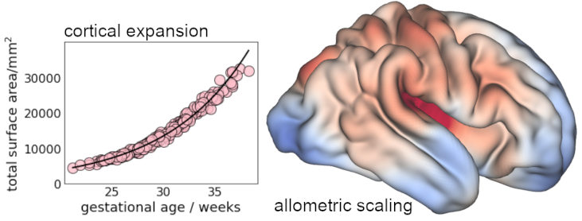
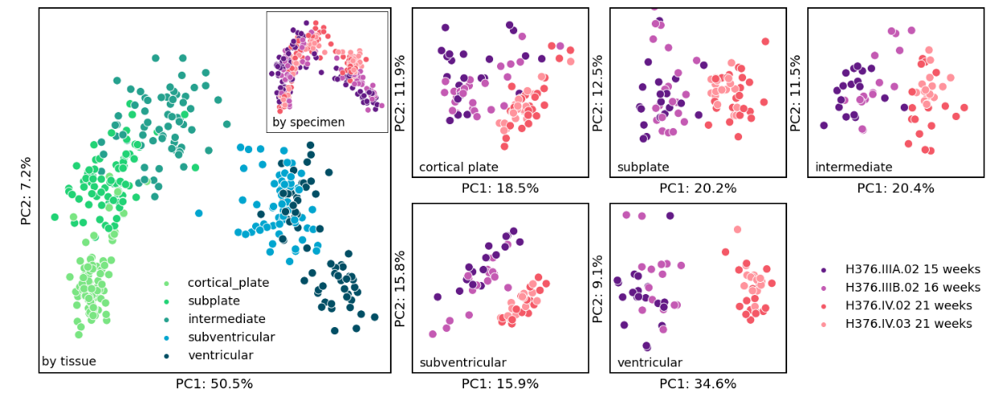
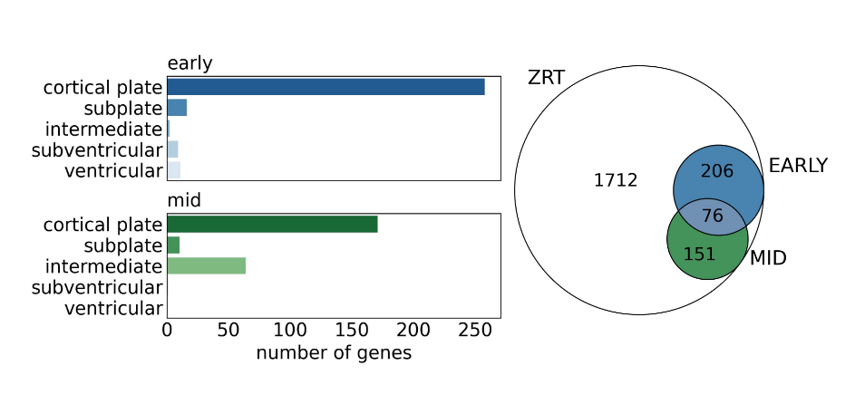
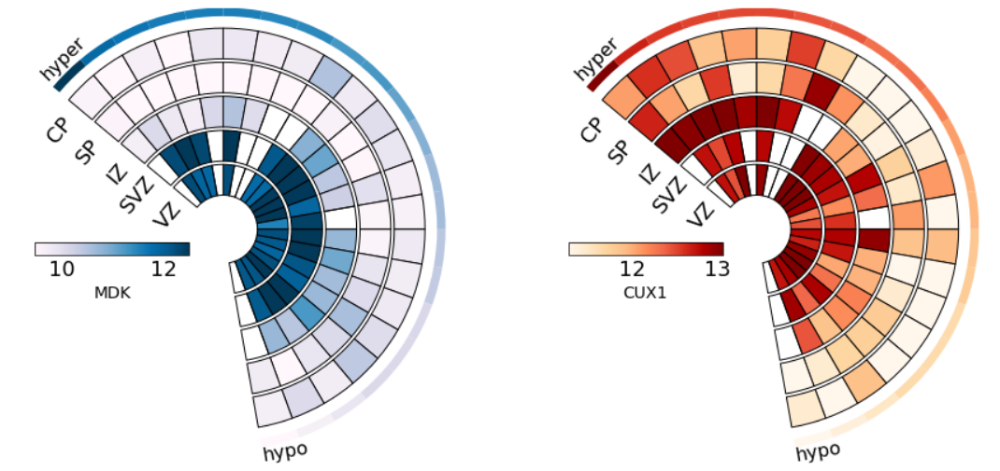
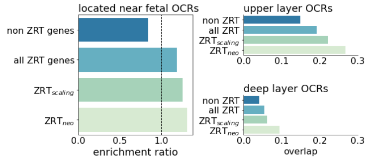

# Molecular signatures of cortical expansion in the human foetal brain

**Ball, G., Oldham, S., Kyriakopoulou, V., Williams, L.Z.J., Karolis, V., Price, A., Hutter, J., Seal, M.L., Alexander-Bloch, A., Hajnal, J.V., Edwards, A.D., Robinson, E.C. & Seidlitz, J.**
*Nature Communications* (2024). [doi:10.1038/s41467-024-54034-2](https://doi.org/10.1038/s41467-024-54034-2)
&middot; [bioRxiv preprint](https://www.biorxiv.org/content/10.1101/2024.02.13.580198v1)

## Summary
The cerebral cortex expands dramatically during the third trimester of pregnancy, but not all areas grow at the same rate. This is the study that introduced the [&mu;Brain atlas]({{ '/micro-brain/about' | relative_url }}). We used &mu;Brain as a common coordinate space to bring together in utero MRI of the growing fetal cortex and gene expression measured in post-mortem tissue at mid-gestation.

Cortical areas that expand fastest before birth show molecular signs of a longer period of neurogenesis and neuronal migration, and a later switch to the production of glial cells. Genes that mark these fast-growing areas are switched on from mid-gestation, are highly expressed in the expanding neocortex, and are linked to genetic disorders with cognitive consequences.

## Preferential cortical expansion in the third trimester
Using in utero MRI from the [Developing Human Connectome Project](http://www.developingconnectome.org/) (190 fetuses scanned between 21 and 38 weeks' gestation), we mapped how quickly each part of the cortex grows relative to the cortex as a whole. Lateral neocortex, including the insula, frontoparietal operculum and primary sensorimotor cortex, expands faster than average; medial and allocortical areas, including the cingulate, expand more slowly.

see: [**01-scaling-models.ipynb**](https://github.com/garedaba/micro-brain/blob/main/ANALYSIS/01-scaling-models.ipynb)

## Gene expression in the mid-gestation brain
Microarray data from four prenatal specimens (15&ndash;21 post-conception weeks) were matched to the &mu;Brain cortical atlas, giving expression for 8,771 genes across up to 27 cortical regions and 5 tissue zones. Expression varies most between proliferative and post-mitotic zones. Around a quarter of genes (n=2,145) vary across tissue zone, cortical region *and* developmental time. We call these *ZRT* genes. They are enriched for neurodevelopmental functions and for genes implicated in autism.

see: [**02-gene-correlations.ipynb**](https://github.com/garedaba/micro-brain/blob/main/ANALYSIS/02-gene-correlations.ipynb) and [**03-ZRT-gene-analysis.ipynb**](https://github.com/garedaba/micro-brain/blob/main/ANALYSIS/03-ZRT-gene-analysis.ipynb)

## Gene expression and areal expansion
About one in five ZRT genes is associated with how quickly a region will expand later in gestation, most often in the cortical plate. Slower-growing allocortical areas are marked by early-born Cajal-Retzius cell markers, while faster-growing neocortex is marked by progenitor and deep-layer neuron markers.

see: [**04-gene-expression-and-areal-scaling.ipynb**](https://github.com/garedaba/micro-brain/blob/main/ANALYSIS/04-gene-expression-and-areal-scaling.ipynb)

## Prolonged neurogenesis and delayed gliogenesis
In the neocortex, faster-expanding areas show enrichment of neuronal markers in the intermediate zone at 21 weeks, consistent with ongoing neuronal migration. Slower-expanding areas show enrichment of glial progenitor markers, consistent with an earlier switch to gliogenesis. For example, *CUX1*, a marker of upper-layer neurons, increases in the intermediate zone along the gradient from slow- to fast-expanding cortex.

see: [**05-scaling-characterisation.ipynb**](https://github.com/garedaba/micro-brain/blob/main/ANALYSIS/05-scaling-characterisation.ipynb)

## Regulatory elements and genetic risk
ZRT genes are more likely to sit near open chromatin regions of the fetal brain, particularly those linked to upper-layer neurons. Genes marking fast-expanding cortex are highly intolerant to loss-of-function variation and are enriched for common genetic variants associated with schizophrenia.

see: [**06-open-chromatin.ipynb**](https://github.com/garedaba/micro-brain/blob/main/ANALYSIS/06-open-chromatin.ipynb)

## Data resources & references
Ding, S.-L. et al. Cellular resolution anatomical and molecular atlases for prenatal human brains. J. Comp. Neurol. 530, 6–503 (2022)

Miller, J. A. et al. Transcriptional landscape of the prenatal human brain. Nature 508, 199–206 (2014)

[Developing Human Connectome Project](http://www.developingconnectome.org/) &middot; [BrainSpan atlas](https://www.brainspan.org/)
