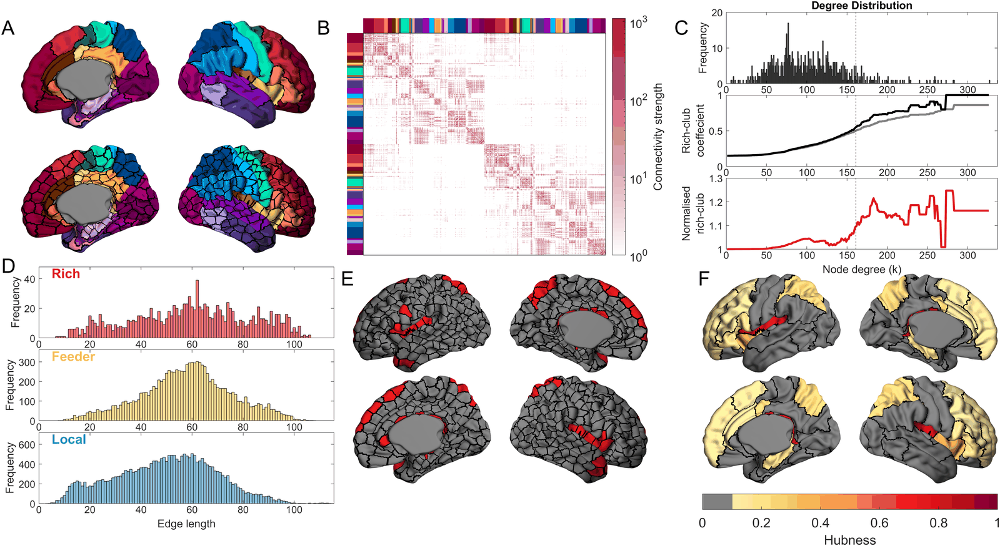
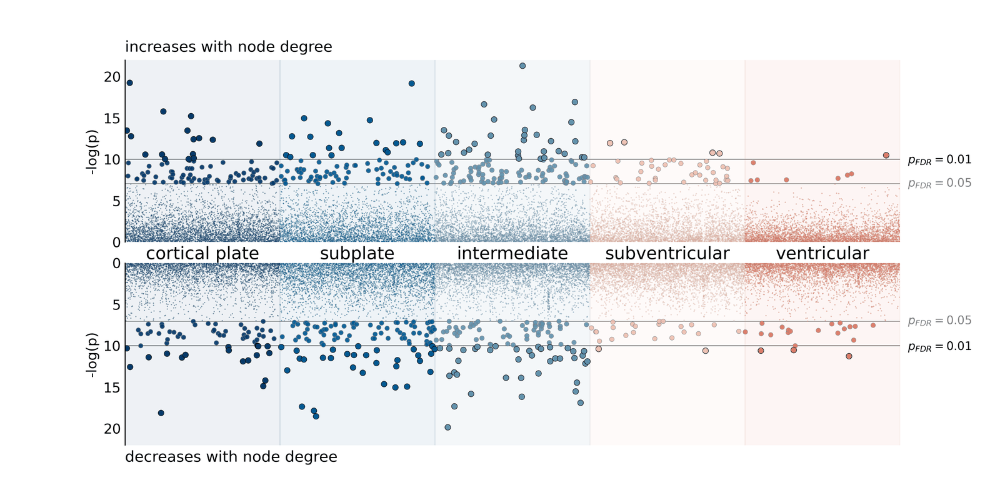
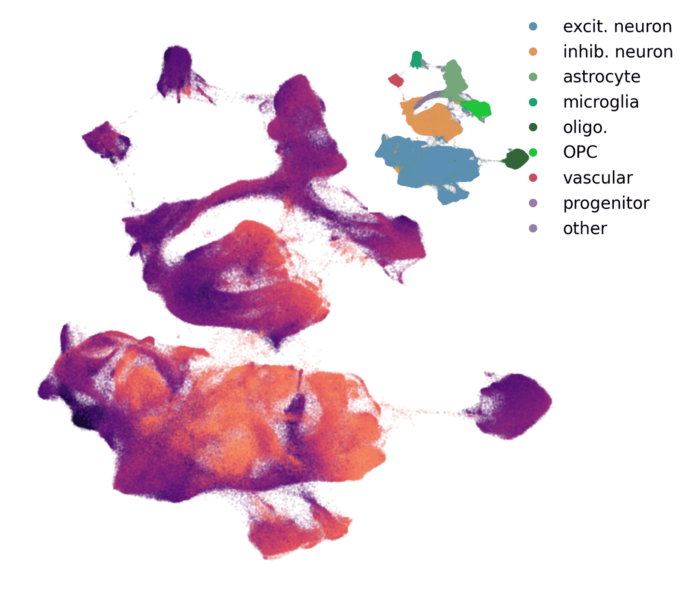

# Transcriptomic divergence of network hubs in the prenatal human brain

**Oldham, S. & Ball, G.** *Communications Biology* (2025). [doi:10.1038/s42003-025-08962-4](https://doi.org/10.1038/s42003-025-08962-4)
&middot; [bioRxiv preprint](https://www.biorxiv.org/content/10.1101/2025.05.26.656237v1)

## Summary
The most densely connected regions of the brain's network, its hubs, sit mainly in association and paralimbic cortex. We identified cortical hubs in structural connectomes from 208 term-born neonates, mapped them onto the cortical regions of the &mu;Brain atlas, and compared regional gene expression across tissue zones at mid-gestation.

Genes with higher expression in future hub regions are involved in early neural circuit formation, are expressed mostly in the transient subplate and intermediate zones, and are enriched in excitatory neuronal lineages. Many overlap with markers of cortical expansion and interhemispheric connectivity in the adult brain.

## Network hubs at birth
Using diffusion MRI from the [Developing Human Connectome Project](http://www.developingconnectome.org/), we built a high-resolution structural network for the newborn cortex by subdividing each &mu;Brain region into smaller parcels. A small set of highly connected nodes form a densely interconnected *rich club*, linked by long-range connections. These hubs are located in the insula, cingulate, ventrolateral frontal and dorsal parietal cortex. The same pattern is found in individual neonates, suggesting that the core hub architecture of the brain is already in place at birth.

see: [**MATLAB code**](https://github.com/garedaba/prenatal-hubs/blob/main/MATLAB/README.md) for all network analyses

## Gene expression associated with hub status
We matched microarray data from four prenatal specimens (16&ndash;21 post-conception weeks) to the &mu;Brain atlas and tested whether regional gene expression before birth predicts which regions will become hubs. Several hundred genes are associated with hub status, almost all in the post-mitotic cortical plate, subplate and intermediate zones rather than in proliferative zones.

Genes with higher expression in future hubs (*hub+* genes) include transcription factors and genes involved in dendrite growth, neurite outgrowth and axon guidance, such as *CUX1*, *NR4A2* and *EFNA5*, and are enriched for synapse assembly and organisation. Genes with lower expression in future hubs (*hub&minus;* genes) include regulators of progenitor fate and neuronal differentiation, such as *EMX2* and *NEUROD1*.

see: [**A_run_gene_models.ipynb**](https://github.com/garedaba/prenatal-hubs/blob/main/A_run_gene_models.ipynb)

## Cell type enrichment
Using single-cell data spanning prenatal and postnatal cortical development, we find that hub+ genes are enriched in excitatory neuronal lineages, most strongly in deep-layer intratelencephalic neurons and subplate neurons. Expression of hub+ genes increases as neurons mature, and peaks in bulk tissue during mid-to-late gestation, coinciding with the developmental peak of the subplate.

see: [**B_cell_enrichments.ipynb**](https://github.com/garedaba/prenatal-hubs/blob/main/B_cell_enrichments.ipynb)

## Links to cortical expansion and adult connectivity
Hub genes overlap with genes that mark areas of rapid [cortical expansion]({{ '/micro-brain/cortical_expansion/' | relative_url }}) in the fetal brain and are enriched near human-specific genomic regions. In the intermediate zone, hub+ genes are enriched for common genetic variants associated with interhemispheric connectivity in adults. Together these suggest that hub regions follow an accelerated developmental timeline, giving them a longer window for circuit integration before birth.

Other analyses were performed with FUMA's [*gene2func*](https://fuma.ctglab.nl/) module and [*MAGMA*](https://cncr.nl/research/magma/).

## Data resources & references
Ball, G. et al. Molecular signatures of cortical expansion in the human foetal brain. Nat. Commun. 15, 9685 (2024)

Velmeshev, D. et al. Single-cell analysis of prenatal and postnatal human cortical development. Science 382, eadf0834 (2023)

Miller, J. A. et al. Transcriptional landscape of the prenatal human brain. Nature 508, 199–206 (2014)

[Developing Human Connectome Project](http://www.developingconnectome.org/) &middot; [BrainSpan atlas](https://www.brainspan.org/)
