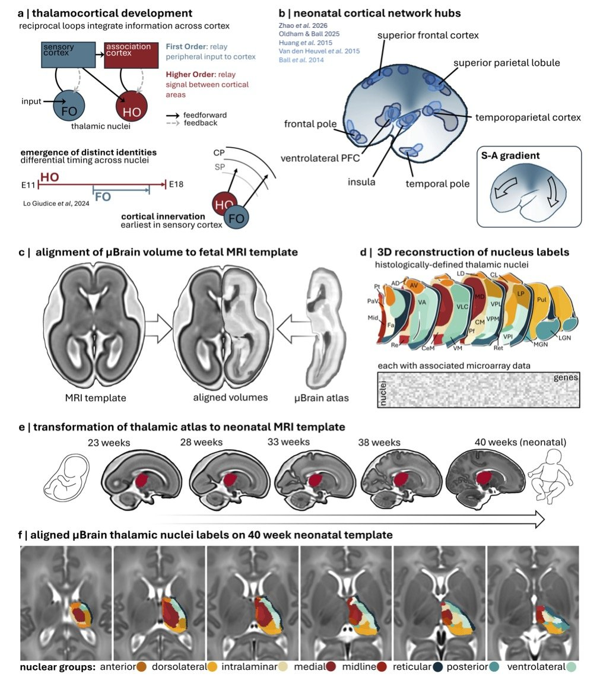
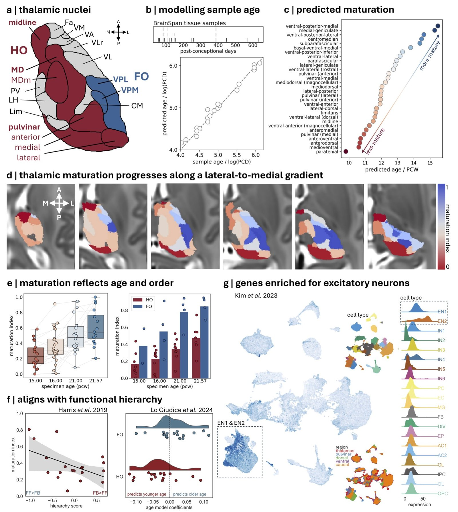
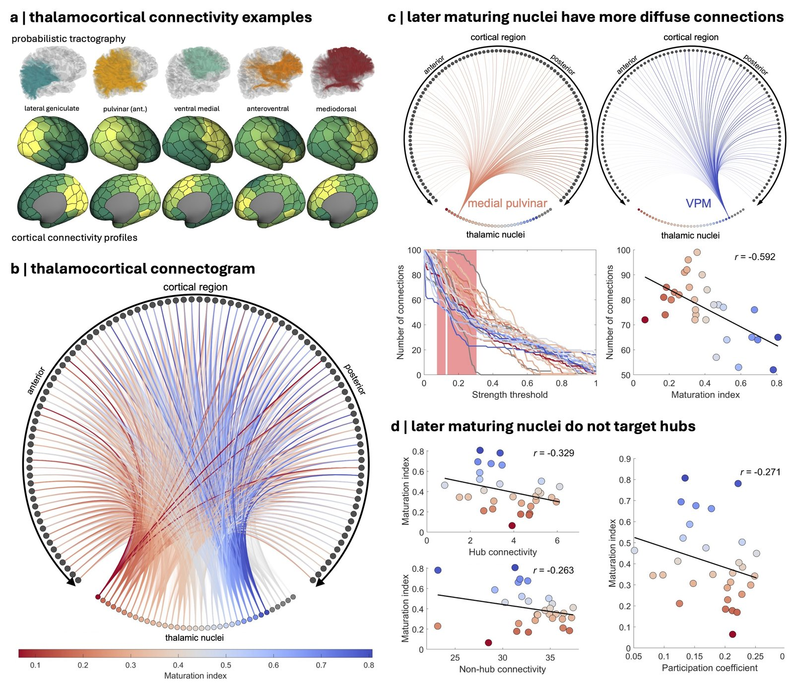
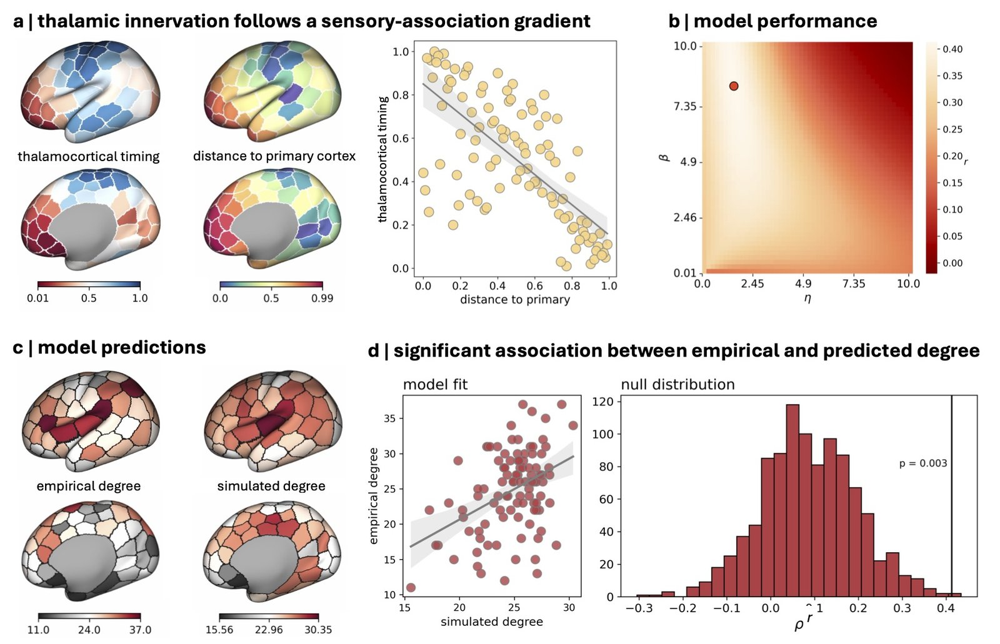

# Thalamocortical constraints on areal connectivity in the developing human brain

**Oldham, S., Yang, J.Y., Lautarescu, A., Bonthrone, A.F., Cruddas, J., Tournier, J.D., Batalle, D. & Ball, G.**
*Science Advances* (accepted). [bioRxiv preprint](https://www.biorxiv.org/content/10.64898/2026.03.24.714079v1)
<!-- TODO: replace with the Science Advances DOI once published -->

## Summary
We combined neonatal diffusion MRI, post-mortem gene expression data and network modelling to ask how the timing and spatial extent of thalamic input to the cortex shape cortical networks before birth.

Thalamic nuclei mature on different schedules: sensory relay nuclei develop ahead of higher-order nuclei. Later-maturing nuclei project to a broader set of cortical areas but do not preferentially target network hubs. Our models suggest that cortical hubs emerge from the combined effects of wiring distance and regional differences in the timing of thalamic input.

## A 3D atlas of the prenatal thalamus
Building on the &mu;Brain atlas, we created a 3D atlas of the mid-gestation thalamus, with thalamic nuclei matched to microarray gene expression data from four prenatal specimens (15&ndash;21 post-conception weeks). The atlas is aligned to fetal and neonatal MRI templates from the [Developing Human Connectome Project](http://www.developingconnectome.org/), allowing gene expression in individual nuclei to be related to thalamocortical connections measured with MRI.

The thalamic atlas and matched microarray data are available on [Zenodo](https://doi.org/10.5281/zenodo.10622336).

## Thalamic maturation follows the functional hierarchy
Thalamic nuclei express genes for morphogens, thalamic identity, axon guidance and excitatory neuron function. We trained a model to predict tissue age from bulk RNA-seq of the developing thalamus and applied it to individual nuclei at mid-gestation. First-order sensory relay nuclei, such as the medial geniculate and ventral posterior nuclei, appear more mature than higher-order midline, anterior and pulvinar nuclei. Maturation follows a lateral-to-medial gradient that mirrors the feedforward&ndash;feedback hierarchy of the mouse thalamus. The genes that track age are expressed mainly by excitatory thalamic neurons.

see: [**01_age_model.py**](https://github.com/garedaba/prenatal-thalamus/blob/main/analysis/01_age_model.py), [**02_nucleus_maturation.py**](https://github.com/garedaba/prenatal-thalamus/blob/main/analysis/02_nucleus_maturation.py), [**03_fo_ho_hierarchy.py**](https://github.com/garedaba/prenatal-thalamus/blob/main/analysis/03_fo_ho_hierarchy.py) and [**04_single_cell_expression.py**](https://github.com/garedaba/prenatal-thalamus/blob/main/analysis/04_single_cell_expression.py)

## Later-maturing nuclei connect widely but do not target hubs
Using diffusion MRI tractography in 182 term-born neonates, we mapped the cortical connections of each thalamic nucleus. Connectivity is topographically organised, with neighbouring nuclei sharing cortical targets. First-order nuclei form focal connections centred on primary sensory cortex, while later-maturing, higher-order nuclei reach a broader set of cortical areas with more diffuse connections. However, later-maturing nuclei do not connect preferentially to cortical hubs.

## Distance and timing constraints shape cortical hubs
We built a generative model of cortico-cortical connectivity in which the probability of two areas connecting depends on the distance between them and on how closely the timing of their thalamic innervation matches. Estimated innervation timing increases with distance from primary sensory cortex. A model combining both constraints reproduces the spatial distribution of hubs in the neonatal cortex better than models based on distance alone. Hubs emerge roughly midway between primary sensory cortex and the frontal and temporal poles, a position that maximises overlap in the timing of innervation while limiting wiring cost.

Removing the timing constraint from primary visual cortex in the model produces changes in connectivity that mirror the effects of experimental thalamic deafferentation.

see: [**05_generative_model.py**](https://github.com/garedaba/prenatal-thalamus/blob/main/analysis/05_generative_model.py), [**06_model_fit.py**](https://github.com/garedaba/prenatal-thalamus/blob/main/analysis/06_model_fit.py), [**07_null_models.py**](https://github.com/garedaba/prenatal-thalamus/blob/main/analysis/07_null_models.py) and [**08_ablation.py**](https://github.com/garedaba/prenatal-thalamus/blob/main/analysis/08_ablation.py)

## Data resources & references
Ball, G. et al. Molecular signatures of cortical expansion in the human foetal brain. Nat. Commun. 15, 9685 (2024)

Kim, C. N. et al. Spatiotemporal molecular dynamics of the developing human thalamus. Science 382, eadf9941 (2023)

Miller, J. A. et al. Transcriptional landscape of the prenatal human brain. Nature 508, 199–206 (2014)

Harris, J. A. et al. Hierarchical organization of cortical and thalamic connectivity. Nature 575, 195–202 (2019)

[Developing Human Connectome Project](http://www.developingconnectome.org/) &middot; [BrainSpan atlas](https://www.brainspan.org/) &middot; [PsychENCODE](http://development.psychencode.org/)
